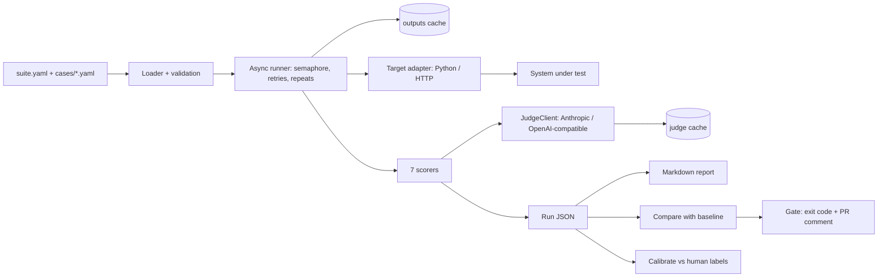

# PLAN — casegate

> AUTHORITATIVE ORDER: `SPEC.md` and `docs/adr/` win over this file. This file explains the why and the shape; SPEC says exactly what to build.

## Premise

casegate is a small Python library, CLI and GitHub Action. It runs labelled cases against any LLM system, scores the answer and the tool trajectory, compares the run with a committed baseline and fails the pull request on regression. It is portfolio project 2 of 5 in a four-week AI-engineer job plan (2026-11-10). The other projects use it for their numbers, so its core ships first (day 2). The brief named it `evalgate`; that name was taken (ADR 0001).

The point is that it is small enough to read in one sitting and that every line can be explained in an interview. References studied, not cloned: promptfoo (cases as config, reporting), deepeval (pytest-style metrics), inspect_ai (task / solver / scorer split).

## Scope

In: YAML cases; a target interface (Python and HTTP adapters); seven scorer files (`exact`, `contains`/`not_contains`, `json_schema`, `tool_trajectory`, `state_match`, `llm_judge`, `citation_support`); concurrent runner with retries, repeats and two caches; JSON and Markdown reports; baseline comparison with per-case flips; a gate with exit codes; judge calibration; a reusable GitHub Action with a sticky PR comment; PyPI release; a one-page site; launch assets.

Out: hosted dashboard, dataset generation, red-teaming suites, statistical tests, plugin systems, provider routers.

## Architecture

## Key choices (each has an ADR)

1. Name `casegate` (0001).
2. A case passes only when every scorer passes (0002).
3. Errors are not failures; they have their own gate limit (0003).
4. Judge through a tiny two-adapter client; Anthropic gets no temperature (0004).
5. Two caches, so a rubric edit re-grades without re-running the agent (0005).
6. Gate tolerance comes from measured variance, not a guess (0006).
7. Visual direction "Lab instrument" (0007).
8. The PR gate reads the baseline from the base branch; baseline edits need the `baseline-update` label (0008).

## What was observed before writing the spec (FACTS)

- Haiku 5.5 runs the toy tool loop with parallel tool calls for $0.0005 a case.
- Sonnet 5.5 structured-output judging costs $0.0021 a call, is not deterministic (0.8 / 0.85 / 0.8), and was lenient on a hedged reply. That example is the first recorded judge disagreement.
- The current Anthropic SDK and API reject `temperature`.

## Roadmap

M0 scaffold → M1 core runner → M2 judge, cache, gate, toy agent, baseline (core ships) → M3 calibration, Action, demo PRs, PyPI → M4 brand and site → M5 launch films and assets. Details and done-criteria: `BUILD.md`.

## Interview talking points this build must support

- Why trajectory scoring matters more than final-answer scoring for agents (case 1: right words, wrong tool order).
- How the gate tolerance was chosen from measured run-to-run variance (ADR 0006).
- One case where the judge was wrong and how calibration exposed it (FACTS §4.2 + calibration disagreements).
