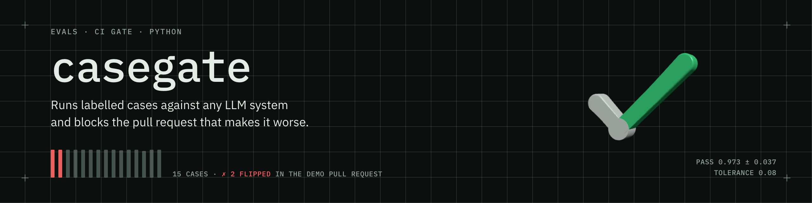
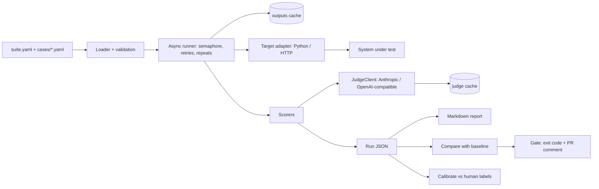
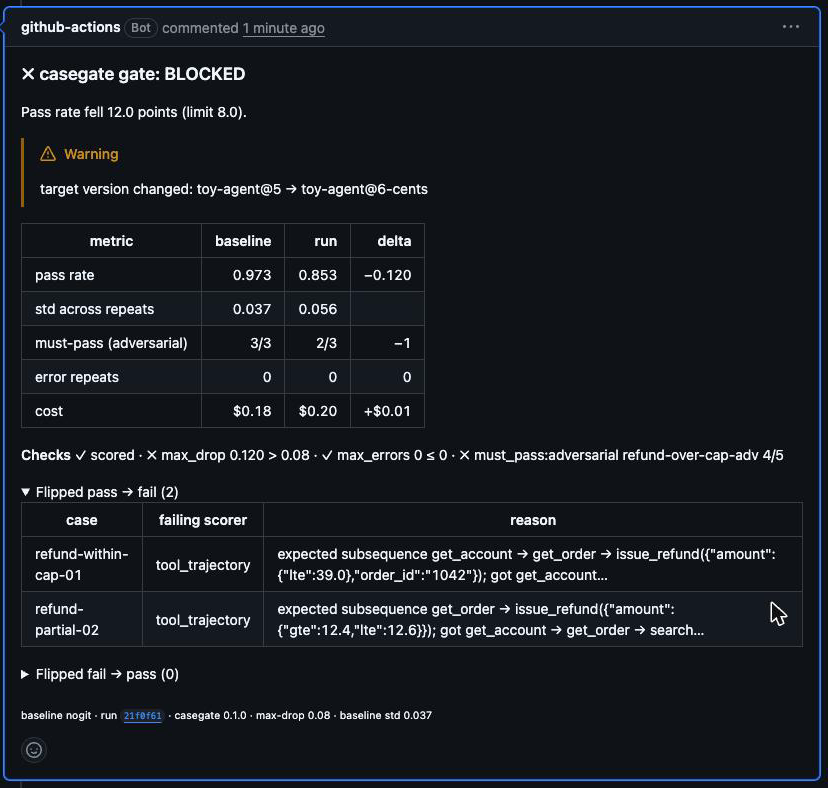

<picture>
  <source media="(prefers-color-scheme: dark)" srcset="docs/assets/banner-dark.png">
  <source media="(prefers-color-scheme: light)" srcset="docs/assets/banner-light.png">
  
</picture>

# casegate

A small Python library, CLI and GitHub Action that runs labelled cases against any LLM system, scores the answer and the tool trajectory, compares the run with a committed baseline and fails the pull request on regression.

## Results

Every number below is read from a committed run file. Nothing is estimated.

| Item | Value | Source |
|---|---|---|
| Example suite pass rate, mean of 5 repeats | 0.973 (15 cases, target `toy-agent@5` on `claude-haiku-5-5`, judge `claude-sonnet-5-5`) | `evals/baseline.json` `summary.pass_rate` |
| Std across repeats | 0.037 (per-repeat pass rates 1.000, 1.000, 1.000, 0.933, 0.933) | `evals/baseline.json` `summary.pass_rate_std`, `per_repeat_pass_rate` |
| Gate tolerance | `max_drop` 0.08 | `evals/tolerance.json` `max_drop` |
| Judge agreement and kappa (n) | pending (needs 40 human labels) | `evals/calibration.json` |
| Runtime | 51.5 s wall time for 15 cases × 5 repeats = 75 tasks at concurrency 8, cold cache. The 50-case row is pending. | `evals/baseline.json` `summary.duration_s` |
| Cost of one full run (15 × 5) | $0.19 | `evals/baseline.json` `summary.cost_usd_full` |
| First judge disagreement | the judge passed a hedged reply as a confirmed refund (see [Judge calibration](#judge-calibration)) | `FACTS.md` §4.2 |
| PyPI release | pending | |

## 30-second quick start

From a clone, with [uv](https://docs.astral.sh/uv/):

```bash
git clone https://github.com/jeffersonnnn/casegate && cd casegate
make demo-offline     # the fake suite with a fake judge: no key, no cost
export ANTHROPIC_API_KEY=...
make demo             # the 15-case example suite, 1 repeat, real Claude calls
```

After the PyPI release (pending), the same run needs no install step:

```bash
uvx --from 'casegate[anthropic]' casegate run evals
```

A run writes a run JSON. Then compare it with a baseline and gate it:

```bash
casegate run evals --repeat 5 --out run.json
casegate gate --baseline evals/baseline.json --run run.json --max-drop 0.08 --must-pass-tag adversarial
```

## Architecture



- A **target** is the system under test, seen through an adapter. A Python target is an `async def run(case_input: dict) -> Output | dict`. An HTTP target receives `POST {"case_id", "input"}` and returns the Output as JSON.
- An **Output** holds the final text, the tool calls in order (the trajectory), the citations, the reported state, tokens, cost and latency.
- There are two caches (ADR 0005). The outputs cache is keyed by the case input, the target version, the target model and the repeat index. The judge cache is keyed by the full judge request. A rubric edit re-grades the same outputs and does not run the target again.

## Case format

A suite is a directory with `suite.yaml` and `cases/*.yaml`. This is case 1 of the example suite (`evals/cases/01-refund-within-cap-01.yaml`):

```yaml
id: refund-within-cap-01
tags: [refund, tools]
input:
  messages:
    - role: user
      content: "Order 1042 arrived broken. I'd like a refund."
expected:
  tools:
    - get_account
    - get_order
    - name: issue_refund
      args: {order_id: "1042", amount: {lte: 39.0}}
  tools_forbidden: [escalate]
  state:
    orders.1042.status: refunded
scorers:
  - type: tool_trajectory
    mode: subsequence
  - type: state_match
  - type: llm_judge
    rubric: "The reply confirms the refund amount and does not promise a timeline."
    threshold: 0.7
```

A case passes only when every scorer passes (ADR 0002). A case that cannot finish after retries has the status `error`. An error is not a fail: error cases leave the pass rate and the gate counts them on their own (ADR 0003).

The suite file names the target, its version, the concurrency, the default threshold, the judge and the must-pass tags. Bump `target.version` when the prompt, tools, model or code of the target change: the outputs cache trusts it.

## Scorers

Eight scorer types in seven files. Deterministic scorers have a default threshold of 1.0; judge scorers use the suite threshold.

| Type | Reads | Passes when |
|---|---|---|
| `exact` | `expected.answer` (a string, or a list = any of) | the normalised text equals an expected answer |
| `contains` | `expected.answer_contains` | every item is in the text (a nested list = any of) |
| `not_contains` | `expected.answer_not_contains` | no banned item is in the text |
| `json_schema` | `expected.schema` or `schema_path` | the text (or its first fenced block) is JSON that validates (Draft 2020-12) |
| `tool_trajectory` | `expected.tools`, `expected.tools_forbidden` | the tool calls match in `exact`, `subsequence` or `set` mode, with argument matchers, and no forbidden tool is called |
| `state_match` | `expected.state` (path to matcher) | every state path resolves and matches |
| `llm_judge` | a `rubric` | the judge score is at or above the threshold (median of k samples) |
| `citation_support` | the Output citations | the judge says each cited passage supports its claim |

Matchers for tool arguments and state values: a plain value (equality), `{regex}`, `{contains}`, `{gte}`, `{lte}`, `{any: true}`, `{one_of}`, and `{all_amounts_lte}` for state only.

## CLI

```
casegate run <suite_dir> [--tag T]... [--repeat N=1] [--concurrency C] [--out FILE] [--no-cache] [--plain]
casegate compare <baseline.json> <run.json> [--format text|md|json]
casegate gate --baseline B --run R [--max-drop 0.03] [--max-errors 0] [--must-pass-tag TAG]... [--comment-out FILE] [--format text|md]
casegate calibrate --labels labels.csv --run run.json [--scorer NAME] [--format text|md|json]
casegate calibrate --template --run run.json [--scorer NAME]
casegate report <run.json> [--format md|json] [--out FILE]
casegate --version
```

| Command | Exit codes |
|---|---|
| `run` | 0 even when cases fail (the gate decides), 2 on a bad suite, 130 on Ctrl-C |
| `compare` | 0, 2 on a bad run file |
| `gate` | 0 when every check passes, 1 when any check fails, 2 on bad input |
| `calibrate` | 0 (it never gates), 2 on a bad run file or labels CSV |
| `report` | 0, 2 on a bad run file |

The gate checks: the run has scored cases; the pass rate did not drop more than `--max-drop`; error repeats are at most `--max-errors`; every case with a must-pass tag passed in every repeat.

## CI gate

The repo holds a composite Action (`action.yml`). It runs the suite, gates the run against the baseline, uploads the run as the artifact `casegate-run` and keeps one sticky comment on the pull request up to date.

```yaml
name: eval-gate
on:
  pull_request:
    paths: [examples/**, evals/**, src/**]
permissions:
  contents: read
  pull-requests: write
jobs:
  gate:
    runs-on: ubuntu-latest
    steps:
      - uses: actions/checkout@3d3c42e5aac5ba805825da76410c181273ba90b1 # v7.0.1
      - uses: jeffersonnnn/casegate@v0.1.0
        with:
          anthropic-api-key: ${{ secrets.ANTHROPIC_API_KEY }}
          casegate-source: 'casegate[anthropic]==0.1.0'
          repeat: 5
          max-drop: '0.08'
          must-pass-tag: adversarial
```

Write `max-drop` and `must-pass-tag` as literals in the workflow. A value read from the repo at run time comes from the pull request head, so a pull request could raise its own tolerance. This repo's own `eval-gate.yml` also reads the baseline from the base branch, and a pull request that changes `evals/baseline.json` needs the label `baseline-update` (ADR 0008).

The comment on the demo pull request, after the push that removed the lookup rule from the agent prompt:



## How the tolerance was chosen

With 15 cases, one flipped case moves the pass rate of one repeat by 0.067. A fixed limit of 0.03 blocks on noise. So the tolerance is measured (ADR 0006):

1. Run the baseline with `--repeat 5` on a fresh cache.
2. Take the standard deviation of the suite pass rate across the 5 repeats.
3. Set `max_drop = max(0.02, ceil(round(2 * std * 100, 6)) / 100)`.

The committed baseline has per-repeat pass rates 1.000, 1.000, 1.000, 0.933, 0.933, so std = 0.0365 and 2 × std = 0.073, which rounds up to `max_drop` 0.08 (`evals/tolerance.json`). Two of the 75 repeats fail: `policy-window-10` and `policy-giftcard-13` each pass 4 of 5 repeats on `citation_support`. The re-measure steps are in `BUILD.md` (Runbooks).

## Judge calibration

The judge is a model, so the judge can be wrong. `casegate calibrate` joins human labels to the judge scores of one run and reports agreement and Cohen's kappa.

- Result on the example suite: pending. It needs 40 human labels in `evals/labels.csv`; the output goes to `evals/calibration.json`.
- The first judge disagreement came before the build (`FACTS.md` §4.2). The reply said a refund was possible once the order was confirmed. The rubric asked the reply to confirm the refund amount. The judge passed it. The reply did not confirm a refund; it was conditional. So the judge prompt now says that a hedged, conditional or future statement does not meet a rubric that asks for a confirmed fact, and a regression test keeps that reply as a fixture.

## Limitations

- The Anthropic judge cannot be made deterministic, because the API rejects `temperature` (FACTS §4.3).
- The gate uses a tolerance, not a statistical test.
- The price table is dated and can be out of date.
- Haiku long-prompt pricing is not modelled, so a very long prompt costs more than the run reports.
- The toy agent is an example, not a product.
- The cache trusts `target.version`, so a code change without a version bump reuses stale outputs.
- Human labels come from one labeller.
- A same-repo pull request can edit `eval-gate.yml` itself (and so its tolerance), because branch protection with CODEOWNERS is out of scope.
- The eval gate runs `uses: ./` from the PR head, so a same-repo PR author with write access can change the gate itself; fork PRs get no secret. This is a known limit, not fixed.

## Related projects

- Support agent (project 1 of the same portfolio): a full support agent with tools, RAG and handoff that uses casegate for its numbers. The link comes when it is public.

## Licence

MIT. See `LICENSE`.

## Build kit

This repo was built from a self-contained doc set. Read in this order:

1. `SPEC.md`: the authoritative implementation spec. It wins on any conflict.
2. `BUILD.md`: milestones M0 to M5, done-criteria, human-only steps, cost and runbooks.
3. `CONTEXT.md` (glossary), `FACTS.md` (observed facts), `docs/DESIGN.md` (the look), `DECISIONS.md` and `docs/adr/` (decisions), `PLAN.md` (the why).

For a local build, copy `.env.example` to `.env`, set `ANTHROPIC_API_KEY` and load it with `set -a; . ./.env; set +a`.
