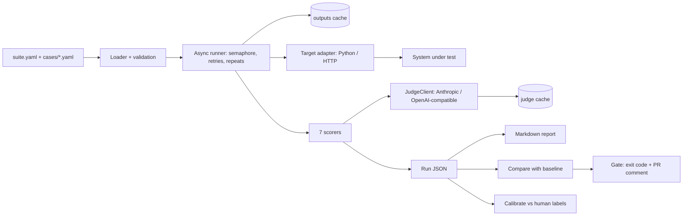
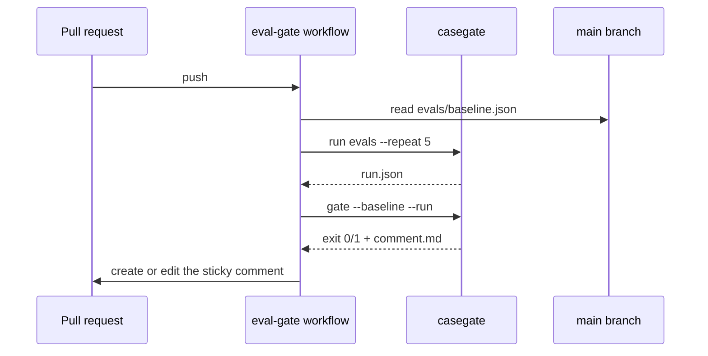
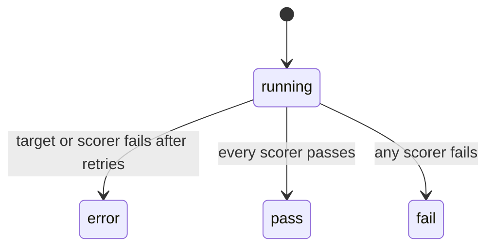
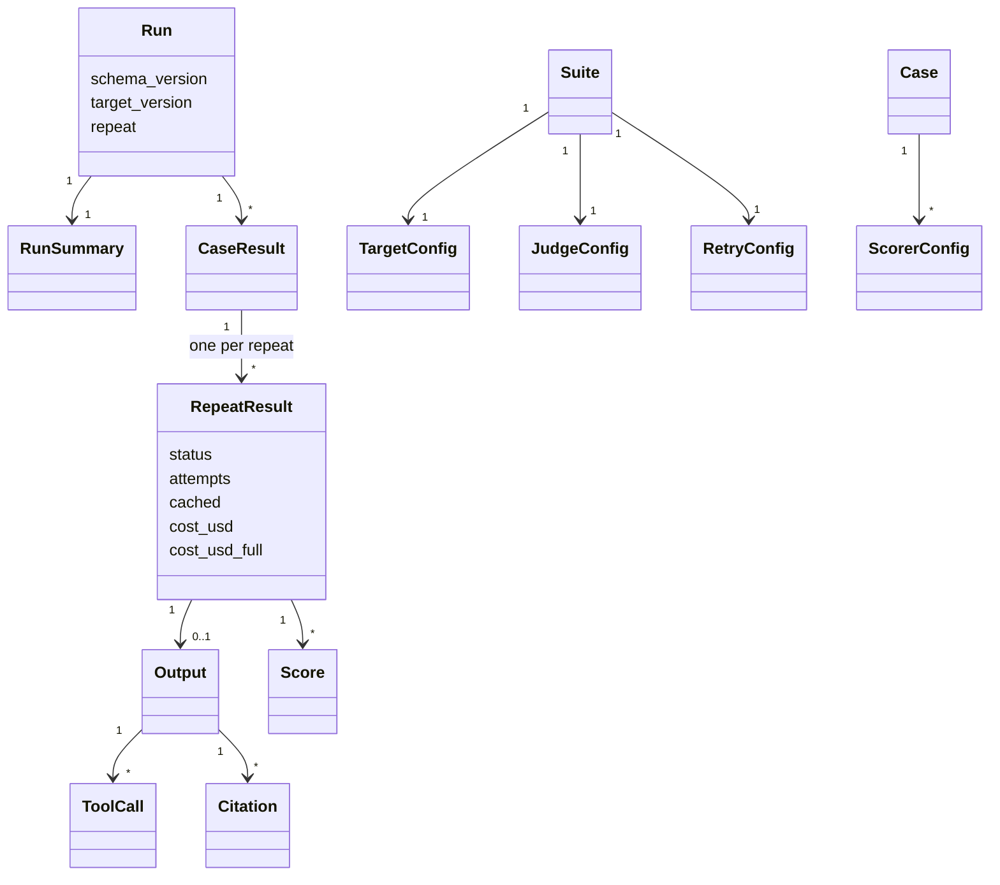

# Diagrams

## Architecture

Whiteboard: draw left to right. Cases in, runner in the middle with two cylinders (caches), run JSON on the right. Then the three consumers of the run: report, compare → gate, calibrate.

## One PR, sequence

Whiteboard: four lifelines; the key arrow is the baseline read from main, not from the PR.

## Case status

Whiteboard: three end states; say "error is not fail" (ADR 0003).

## Data model

From `src/casegate/models.py:168-182` `Run` and the models above it.

Whiteboard: draw config on the left (Suite, Case) and results on the right (Run down to Score). Say that Output is None when the repeat errored. Say that every model forbids unknown fields, except ScorerConfig, which keeps scorer params.
